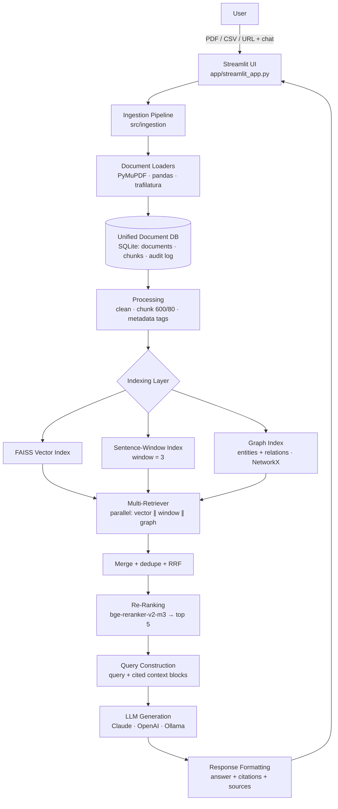

# Advanced Multi-Source RAG for Enterprise Knowledge Base

A production-shaped, bilingual (**Bangla + English**) Retrieval-Augmented Generation system that
ingests **PDF / CSV / URLs**, stores everything in a **unified SQLite document DB**, and answers
questions from three complementary indexes — **FAISS vector**, **sentence-window** and a
**knowledge graph** — merged, deduplicated and re-ranked by a **cross-encoder**, with answers that
are grounded in context and cite `[file_name, page]`.

Built with **LlamaIndex** orchestration, **bge-m3** embeddings, **bge-reranker-v2-m3**, **Claude /
OpenAI / Ollama** LLMs, **NetworkX** graph storage and a **Streamlit** chat UI. Evaluated with
**RAGAS**.

---

## 1. Architecture



ASCII view of the same flow:

```
User → Streamlit UI (CSV/PDF/URL upload)
     → Data Ingestion Pipeline (Document Loaders)
     → Unified Document DB (SQLite)
     → Processing (chunking, cleaning, metadata tagging)
     → Indexing Layer (Vector + Sentence-Window + Graph)
     → Multi-Retriever System (3 retrievers, in parallel)
     → Re-Ranking (merge + dedupe + cross-encoder rerank)
     → Query Construction (query + context)
     → LLM (answer + source citation)
     → Response Format (answer, bullet citations, expandable sources) → User
```

### Why three retrievers?

| Retriever | Strength | Example win |
| --- | --- | --- |
| **Vector (FAISS + bge-m3)** | semantic paraphrase, cross-lingual | "time off" → *annual leave* |
| **Sentence-window (window = 3)** | precise sentence match + local context | exact policy sentence with surrounding conditions |
| **Graph (LLM-extracted entities/relations)** | multi-hop, vocabulary mismatch | "Where is the subsidiary that was launched in 2019?" |

Results are merged with **Reciprocal Rank Fusion** (`Σ wᵣ / (k + rankᵣ)`), deduplicated by node id
*and* normalised text, near-duplicate windows are collapsed, and the surviving candidates are
re-scored by a **cross-encoder**; the best **5** become the prompt context.

---

## 2. Tech stack

| Layer | Tool |
| --- | --- |
| UI | Streamlit (chat, uploads, sources, evaluation) |
| Orchestration | LlamaIndex (`VectorStoreIndex`, `SentenceWindowNodeParser`, `StorageContext`) |
| Loaders | PyMuPDF (`pymupdf`), pandas, trafilatura |
| Document DB | SQLite (WAL, thread-safe) + file store under `data/raw` |
| Embeddings | **BAAI/bge-m3** (default, multilingual), OpenAI `text-embedding-3-small`, offline hashing fallback |
| Vector index | FAISS (`IndexFlatIP`, cosine via normalised vectors) |
| Sentence window | `SentenceWindowNodeParser(window_size=3)` over a second FAISS index |
| Graph index | LLM triple extraction → NetworkX `MultiDiGraph` → `graph.json` |
| Re-ranker | **BAAI/bge-reranker-v2-m3** cross-encoder (GPU auto-detect), Cohere, lexical fallback |
| LLM | Claude API, OpenAI (or compatible gateway), Ollama, grounded extractive fallback |
| Evaluation | RAGAS (faithfulness, answer relevancy, context precision, context recall) + vector baseline |

### Offline / degraded mode (by design)

Every external dependency has an explicit fallback so the system never dies mid-demo or in an
air-gapped environment:

| Primary | Fallback | When |
| --- | --- | --- |
| bge-m3 (HF download) | hashing n-gram embeddings (`EMBEDDING_BACKEND=hashing`) | no model cache / no network |
| bge-reranker-v2-m3 | IDF lexical reranker | cross-encoder unavailable |
| Claude / OpenAI / Ollama | extractive, citation-preserving answer builder | no API key / endpoint down |
| LLM triple extraction | deterministic multilingual heuristic extractor | no LLM |

The UI and every answer expose **which** components actually ran (`provider`, `reranker`,
`retrievers`, `score`), so degraded mode is never silent.

---

## 3. Project structure

```
advanced-multi-source-rag/
├── app/
│   └── streamlit_app.py          # Step 1: UI (upload, chat, sources, eval)
├── src/
│   ├── config.py                 # env-driven settings (pydantic-settings)
│   ├── models.py                 # RawDocument, Chunk, RetrievedContext, RAGAnswer
│   ├── errors.py                 # typed exception hierarchy
│   ├── text_utils.py             # Unicode/Bangla tokenisation, token counting
│   ├── pipeline.py               # Steps 6→10 orchestrator
│   ├── ingestion/
│   │   ├── loaders.py            # PDF, CSV, URL, text loaders + registry
│   │   └── pipeline.py           # Step 2: load → clean → chunk → store
│   ├── storage/
│   │   └── document_db.py        # Step 3: Unified Document DB (SQLite)
│   ├── processing/
│   │   ├── cleaner.py            # boilerplate/page-number removal
│   │   ├── chunker.py            # Step 4: 600 tokens / 80 overlap
│   │   ├── metadata.py           # language, keywords, section, citations
│   │   └── processor.py          # clean → chunk → tag → persist
│   ├── indexing/
│   │   ├── embeddings.py         # bge-m3 / OpenAI / hashing + SQLite cache
│   │   ├── nodes.py              # Chunk ↔ LlamaIndex node bridge
│   │   ├── vector_index.py       # Step 5a: FAISS index
│   │   ├── sentence_window.py    # Step 5b: sentence-window index
│   │   ├── graph_index.py        # Step 5c: LLM triples + NetworkX + persistence
│   │   └── build_all.py          # builds all indexes + manifest (staleness)
│   ├── retrieval/
│   │   ├── base.py               # retriever interface
│   │   ├── vector_retriever.py
│   │   ├── window_retriever.py
│   │   ├── graph_retriever.py
│   │   └── multi_retriever.py    # Step 6: parallel + RRF merge/dedupe
│   ├── rerank/
│   │   └── reranker.py           # Step 7: cross-encoder, batching, GPU auto-detect
│   ├── generation/
│   │   ├── query_builder.py      # Step 8: strict, citation-oriented prompt
│   │   ├── llm.py                # Step 9: Claude/OpenAI/Ollama + retries/streaming
│   │   └── formatter.py          # Step 10: citations, sources, markdown
│   └── evaluation/
│       └── ragas_eval.py         # RAGAS + heuristic fallback + baseline comparison
├── data/
│   ├── raw/                      # uploaded files
│   ├── processed/                # (reserved for exports)
│   ├── indexes/                  # vector/ · sentence_window/ · graph/ · manifest.json
│   ├── db/documents.db           # SQLite
│   ├── samples/                  # demo corpus (PDF, CSV, Bangla TXT, MD)
│   └── evaluation/               # sample_testset.json + generated reports
├── scripts/
│   ├── generate_samples.py       # rebuild the demo corpus
│   ├── build_index.py            # CLI ingest + build indexes
│   ├── ask.py                    # CLI question answering
│   └── run_eval.py               # CLI evaluation (RAGAS / heuristic)
├── tests/                        # 125 pytest tests (loaders, chunker, merge, e2e)
├── .env.example
├── requirements.txt
├── Dockerfile
├── docker-compose.yml
├── Makefile
└── README.md
```

---

## 4. Quick start

### 4.1 Local (Python 3.10+)

```bash
git clone <your-repo-url> && cd Advanced-Multi-Source-RAG

python3 -m venv .venv && source .venv/bin/activate
pip install -r requirements.txt          # or: make install

cp .env.example .env                     # then set LLM_PROVIDER + API key
```

Pick a provider in `.env`:

```ini
# Claude
LLM_PROVIDER=anthropic
ANTHROPIC_API_KEY=sk-ant-...

# OpenAI (or any OpenAI-compatible gateway via OPENAI_BASE_URL)
LLM_PROVIDER=openai
OPENAI_API_KEY=sk-...

# Fully local
LLM_PROVIDER=ollama
OLLAMA_BASE_URL=http://localhost:11434
LLM_MODEL=qwen2.5:7b
```

Generate the demo corpus and build the indexes:

```bash
python scripts/generate_samples.py     # data/samples/* + sample test set
python scripts/build_index.py          # ingest + build vector/window/graph
```

Run the UI and open **http://localhost:8501**:

```bash
streamlit run app/streamlit_app.py
# or: make app
```

Ask from the CLI:

```bash
python scripts/ask.py "How many days of annual leave do employees get?"
python scripts/ask.py "বার্ষিক ছুটি কত দিন?" --show-contexts
```

### 4.2 Docker

```bash
cp .env.example .env            # configure the provider
docker compose up --build       # UI on :8501, demo data auto-indexed on first boot
# with a local Ollama container:
docker compose --profile ollama up --build
docker compose exec ollama ollama pull qwen2.5:7b
```

### 4.3 Zero-network demo mode

```bash
LLM_PROVIDER=extractive \
EMBEDDING_BACKEND=hashing \
RERANKER_BACKEND=lexical \
python scripts/build_index.py && \
LLM_PROVIDER=extractive EMBEDDING_BACKEND=hashing RERANKER_BACKEND=lexical \
streamlit run app/streamlit_app.py
```

No downloads, no API keys: the UI, retrieval, graph index (heuristic triples), citations and the
evaluation script all work.

---

## 5. How it works (steps 1 → 10)

| # | Step | Implementation |
| --- | --- | --- |
| 1 | **UI** | `app/streamlit_app.py` — sidebar uploads (PDF/CSV/TXT/MD), URL box, demo loader, index builder with progress, chat with streaming + citations, KB browser, evaluation tab |
| 2 | **Ingestion** | `src/ingestion/loaders.py` (PyMuPDF page-by-page, pandas row blocks, trafilatura main-content), `src/ingestion/pipeline.py` (save → load → error isolation → DB) |
| 3 | **Unified DB** | `src/storage/document_db.py` — `documents` (raw text, source, type, page, timestamp, JSON metadata), `chunks`, `ingestion_log`, `app_meta`; WAL + per-call connections for thread safety |
| 4 | **Processing** | `cleaner.py` (control chars, hyphenation, page numbers, repeated headers, markdown), `chunker.py` (sentence-aware, **600 tokens / 80 overlap**, deterministic ids), `metadata.py` (language `en/bn/mixed`, keywords, section, citation key) |
| 5 | **Indexing** | `indexing/vector_index.py` (FAISS `IndexFlatIP` over normalised vectors), `sentence_window.py` (`window_size=3`, Unicode splitter for `।`), `graph_index.py` (LLM JSON triples → NetworkX → `graph.json`), `build_all.py` (manifest + staleness fingerprint) |
| 6 | **Multi-retriever** | `retrieval/multi_retriever.py` — `ThreadPoolExecutor`, per-retriever timeouts, failure isolation, RRF fusion, dedupe by id/text, provenance merge |
| 7 | **Re-ranking** | `rerank/reranker.py` — `CrossEncoder(bge-reranker-v2-m3)`, batch inference, `auto` device (cuda/mps/cpu), sigmoid calibration, near-duplicate suppression, top-5 |
| 8 | **Query construction** | `generation/query_builder.py` — numbered context blocks labelled `[2] [handbook.pdf, p.4]`, token-budgeted, strict system prompt, bilingual language hint |
| 9 | **Generation** | `generation/llm.py` — Claude Messages API, OpenAI chat completions, Ollama `/api/chat`; retries, streaming, JSON mode, automatic grounded fallback |
| 10 | **Response format** | `generation/formatter.py` — citation parsing/resolution (`[file, p.N]`), bullet citations, grouped expandable sources, markdown rendering |

### Answer contract

* Answers **only** from retrieved context; the prompt forbids outside knowledge.
* Every factual sentence is followed by `[file_name, page]` (URLs cite without a page).
* If context is missing **or** the best rerank score is below the relevance gate, the answer is
  exactly *“I could not find the answer in the provided documents.”* (Bangla equivalent for Bangla
  questions) and no citation is invented.
* The UI always shows: the answer, bullet citations, and an expandable **Sources** panel with the
  passages, their retrievers, and rerank scores.

---

## 6. Configuration

All settings come from environment variables / `.env` (see `.env.example`). The most useful ones:

| Variable | Default | Meaning |
| --- | --- | --- |
| `LLM_PROVIDER` | `openai` | `anthropic` \| `openai` \| `ollama` \| `extractive` |
| `LLM_MODEL` | provider default | e.g. `gpt-4o-mini`, `claude-3-5-sonnet-latest`, `qwen2.5:7b` |
| `EMBEDDING_BACKEND` | `sentence_transformers` | `sentence_transformers` \| `openai` \| `hashing` |
| `EMBEDDING_MODEL` | `BAAI/bge-m3` | multilingual (Bangla + English) |
| `RERANKER_BACKEND` | `cross_encoder` | `cross_encoder` \| `cohere` \| `lexical` \| `none` |
| `RERANKER_MODEL` | `BAAI/bge-reranker-v2-m3` | cross-encoder id |
| `CHUNK_SIZE_TOKENS` / `CHUNK_OVERLAP_TOKENS` | `600` / `80` | chunking |
| `SENTENCE_WINDOW_SIZE` | `3` | sentences kept on each side |
| `RETRIEVAL_TOP_K` / `RERANK_TOP_N` | `10` / `5` | candidates / final context |
| `USE_RRF` / `RRF_K` | `true` / `60` | fusion strategy |
| `MIN_RERANK_SCORE` | `0` | relevance gate (0 = backend default) |
| `GRAPH_MAX_HOPS` | `2` | graph expansion depth |
| `ALLOW_MODEL_FALLBACKS` | `true` | degrade gracefully instead of failing |

**Changing the embedding model** invalidates the FAISS index (dimension check in `meta.json`);
rebuild with `python scripts/build_index.py --reprocess`.

**Changing chunk size** only requires re-chunking — raw text lives in SQLite:
`python scripts/build_index.py --reprocess`.

---

## 7. Evaluation

```bash
python scripts/run_eval.py                  # RAGAS if an LLM is configured
python scripts/run_eval.py --mode heuristic # offline proxy metrics, no LLM needed
python scripts/run_eval.py --max-samples 5 --no-baseline
```

The script answers the **10-question bilingual test set** (`data/evaluation/sample_testset.json`,
including one deliberately unanswerable question), scores it, **and re-runs a vector-only baseline**
so the value of sentence-window + graph + reranking is measurable. Reports are written to
`data/evaluation/ragas_report_*.json|md`.

Metrics: **faithfulness**, **answer relevancy**, **context precision** (+ **context recall** as a
bonus), plus `refusal_accuracy` for the unanswerable question.

When no LLM judge is available, `--mode heuristic` computes deterministic proxies from embedding
similarity (sentence-support for faithfulness, question↔answer cosine for relevancy, rank-weighted
relevance for context precision). A representative offline run of this repository:

```
| Metric            | Advanced | Vector baseline |
| ----------------- | -------- | --------------- |
| faithfulness      | 0.65     | 0.66            |
| answer_relevancy  | 0.39     | 0.40            |
| context_precision | 0.99     | 1.00            |
| context_recall    | 0.84     | 0.84            |
| refusal_accuracy  | 1.00     | –               |
```

> These numbers use the **offline hashing embedder + extractive answerer**, so they mainly prove the
> plumbing works end-to-end. With bge-m3 + an LLM judge the same script reports real RAGAS scores —
> rerun it after configuring `EMBEDDING_BACKEND=sentence_transformers` and a provider key.

Programmatic use:

```python
from src.evaluation.ragas_eval import RAGASEvaluator

report = RAGASEvaluator(mode="auto", max_samples=10).run(with_baseline=True)
print(report.metrics, report.improvements())
```

---

## 8. Tests

```bash
pytest tests -q                 # 125 tests, fully offline (~5 s)
pytest tests --cov=src --cov-report=term-missing
ruff check src app scripts tests
```

Coverage highlights:

* **loaders** — multi-page PDF, blank/corrupt/password-guarded PDFs, CSV row blocks/Bangla UTF-8/empty files, URL main-content extraction, registry dispatch and error isolation;
* **chunker** — token budget, overlap, deterministic ids, Bengali `।` sentences, over-long sentence splitting, metadata provenance;
* **retriever merge** — dedupe by node id and by text, RRF ordering, weights, top-k, empty/failing-retriever isolation, provenance merge;
* plus cleaner, metadata, SQLite DB, embeddings/cache, all three indexes, graph persistence, reranker, prompt budget, citation resolution, streaming, end-to-end pipeline and evaluation.

---

## 9. Operational notes

* **Cost/latency**: one query = 3 retrievals (parallel, ~10 ms with a warm index) + 1 rerank pass
  (~5–30 ms on CPU for 10 candidates) + 1 LLM call. Graph building is the only expensive ingest step
  (one LLM call per chunk) — run it once, it is persisted.
* **Incremental ingest**: uploads replace chunks for the same source name; the manifest fingerprint
  flags stale indexes in the UI so you know when to rebuild.
* **Thread safety**: SQLite uses WAL + one connection per call; every retriever is independent, so
  `ThreadPoolExecutor` parallelism is safe under Streamlit.
* **Privacy**: with `LLM_PROVIDER=ollama` and `EMBEDDING_BACKEND=sentence_transformers` no document
  text leaves the machine. Cloud providers receive only the top-5 reranked passages.
* **Scanned PDFs**: image-only PDFs have no text layer — add OCR (e.g. Tesseract) before ingestion.
* **Large corpora**: swap `IndexFlatIP` for `IndexIVFFlat` in `vector_index.py` and move the graph to
  Neo4j; the retriever interfaces stay unchanged.

## 10. Troubleshooting

| Symptom | Fix |
| --- | --- |
| `No vector index found…` | run `python scripts/build_index.py` (or “Build / rebuild indexes” in the UI) |
| Answers are generic / no citations | the selected provider has no key → check the warning badge; answers are then extractive |
| `embedding dimension mismatch` | embedding model changed; `python scripts/build_index.py --reprocess` |
| Bengali PDF has no text | scanned PDF (needs OCR); Bengali **text/CSV/URL** sources work out of the box |
| RAGAS asks for a judge LLM | configure a provider key, or use `--mode heuristic` |
| Slow first query | bge-m3 load + FAISS warm-up; subsequent queries are fast (embeddings are cached in `data/indexes/embedding_cache.db`) |

## 11. License

MIT — see [LICENSE](LICENSE).
