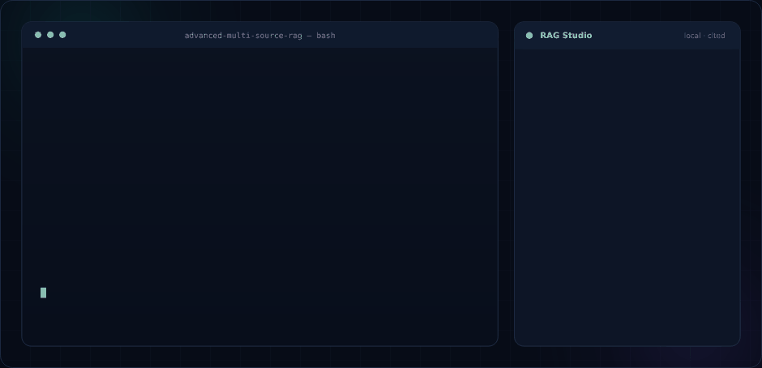
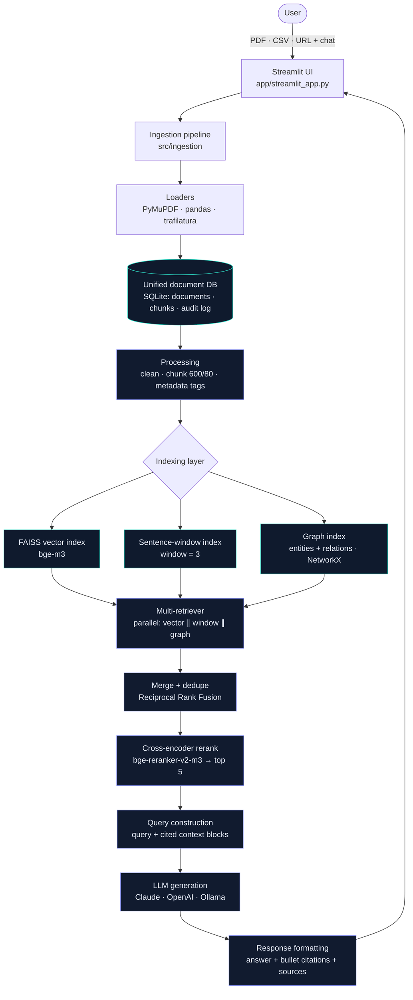
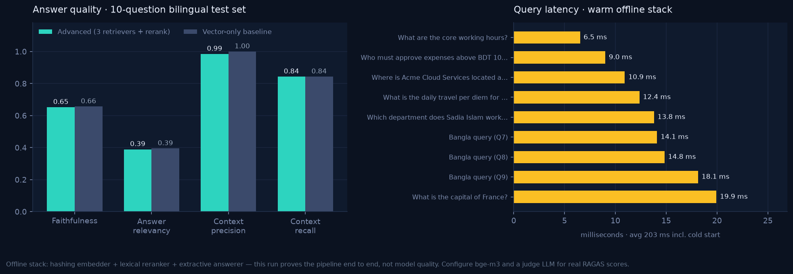

<div align="center">



<br>

**Ask your company's PDFs, spreadsheets and wiki pages in Bangla or English — and get an answer that cites the exact file and page.**

[](.github/workflows/ci.yml)
[](#-tests)
[](#-tests)
[](#-quick-start)
[](#option-b--docker)
[](LICENSE)

[Quick start](#-quick-start) · [Architecture](#-architecture) · [How it works](#-how-it-works-steps-1--10) · [Evaluation](#-evaluation) · [Configuration](#-configuration) · [Design notes](docs/ARCHITECTURE.md)

</div>

---

## 📽️ See it running

<div align="center">

</div>

<div align="center"><sub>Terminal output captured from this repository (offline stack); the chat panel illustrates the UI's answer card and sources.</sub></div>

<br>

<div align="center">

</div>

<div align="center"><sub>Every stage below is implemented in <code>src/</code> and exercised by the test-suite — no stubs, no TODOs.</sub></div>

---

## ✨ Why this project

Most RAG demos stop at "embed the PDF and ask a question". That breaks the moment an enterprise
knowledge base looks like a real one: mixed formats, tables, URLs, two languages, and questions whose
answer spans a sentence, a row **and** a relationship.

This repository is the full pipeline instead:

| | Capability | Why it matters |
| :-: | --- | --- |
| 📥 | **Multi-source ingestion** — PDF, CSV, TXT/MD, live URLs | One knowledge base, not one format |
| 🗄️ | **Unified SQLite document DB** — text, source, type, page, timestamp | Re-chunk without re-uploading; auditable provenance |
| 🧹 | **Cleaning + 600/80 chunking + metadata tagging** | Removes headers/page numbers, tags `en`/`bn`/`mixed` |
| 🧠 | **Three indexes** — FAISS vector, sentence-window (w=3), knowledge graph | Semantics, precision and multi-hop in one query |
| ⚡ | **Parallel retrieval + RRF fusion + dedupe** | Three signals, one ranked candidate list, no duplicates |
| 🎯 | **`bge-reranker-v2-m3` cross-encoder → top 5** | Precision jumps before a single token reaches the LLM |
| 🔒 | **Grounded answers with `[file_name, page]` citations** | Auditable, and refusal when the context is missing |
| 🌏 | **Bangla + English** — `bge-m3`, Unicode-aware splitting (`।`) | Same pipeline, both languages, cross-lingual retrieval |
| 🧪 | **RAGAS evaluation + vector-only baseline** | Measures the value of each added component |
| 🛟 | **Grounded fallbacks for every dependency** | Works offline, in CI, and in an air-gapped demo |

---

## 🏗️ Architecture



<details>
<summary><b>ASCII version</b> (terminals, plain-text review, environments without Mermaid)</summary>

```
User → Streamlit UI (CSV/PDF/URL upload)
     → Data ingestion pipeline (document loaders)
     → Unified document DB (SQLite)
     → Processing (chunking, cleaning, metadata tagging)
     → Indexing layer (vector + sentence-window + graph)
     → Multi-retriever system (3 retrievers, in parallel)
     → Re-ranking (merge + dedupe + cross-encoder rerank)
     → Query construction (query + context)
     → LLM (answer + source citation)
     → Response format (answer, bullet citations, expandable sources) → User
```

</details>

### Why three retrievers?

| Retriever | Strength | Example win |
| --- | --- | --- |
| **Vector** (FAISS + bge-m3) | semantic paraphrase, cross-lingual | "time off" → *annual leave*; English question → Bangla policy |
| **Sentence-window** (window = 3) | precise sentence match + local context | the exact policy sentence with its surrounding conditions |
| **Graph** (LLM-extracted entities/relations) | multi-hop, vocabulary mismatch | "Where is the subsidiary that was launched in 2019?" |

Candidates are fused with **Reciprocal Rank Fusion** (`Σ wᵣ / (k + rankᵣ)`), deduplicated by node id
*and* normalised text, near-duplicate windows are collapsed, and a **cross-encoder** re-scores what
survives; the best **5** passages become the prompt context. A relevance gate then decides between
answering and refusing.

---

## 🚀 Quick start

### Option A — local (recommended)

```bash
git clone https://github.com/BFH-HAMID/Advanced-Multi-Source-RAG.git
cd Advanced-Multi-Source-RAG

python3 -m venv .venv && source .venv/bin/activate
pip install -r requirements.txt           # or: make install
cp .env.example .env                     # pick a provider below
```

Configure the provider in `.env`:

```ini
# Claude
LLM_PROVIDER=anthropic
ANTHROPIC_API_KEY=sk-ant-...

# OpenAI (or any OpenAI-compatible gateway via OPENAI_BASE_URL)
LLM_PROVIDER=openai
OPENAI_API_KEY=sk-...

# Fully local, nothing leaves the machine
LLM_PROVIDER=ollama
OLLAMA_BASE_URL=http://localhost:11434
LLM_MODEL=qwen2.5:7b
```

Build the demo knowledge base and run the UI:

```bash
python scripts/generate_samples.py       # demo PDF/CSV/Bangla/MD corpus + test set
python scripts/build_index.py            # ingest + build vector / window / graph

streamlit run app/streamlit_app.py       # → http://localhost:8501
```

Ask from the CLI instead:

```bash
python scripts/ask.py "How many days of annual leave do employees get?"
python scripts/ask.py "বার্ষিক ছুটি কত দিন?" --show-contexts
```

### Option B — Docker

```bash
cp .env.example .env
docker compose up --build                # UI on :8501, demo data indexed on first boot

# with a local Ollama container in the same network
docker compose --profile ollama up --build
docker compose exec ollama ollama pull qwen2.5:7b
```

### Option C — zero-network demo

No model downloads, no API keys — hashing embeddings, lexical reranker, extractive answerer:

```bash
LLM_PROVIDER=extractive EMBEDDING_BACKEND=hashing RERANKER_BACKEND=lexical \
  python scripts/build_index.py

LLM_PROVIDER=extractive EMBEDDING_BACKEND=hashing RERANKER_BACKEND=lexical \
  streamlit run app/streamlit_app.py
```

Questions, retrieval, graph index (heuristic triples), citations, refusal and evaluation all work.
Swap back to `EMBEDDING_BACKEND=sentence_transformers` + a real provider for full quality.

### Make shortcuts

```bash
make help          # list every target
make install       # venv + deps + .env
make samples index # demo corpus + all three indexes
make app           # Streamlit UI
make ask Q="What is the travel per diem for Chattogram?"
make eval          # RAGAS (or heuristic) evaluation
make test lint     # pytest + ruff
make docker        # build the image
make clean         # drop indexes, DB and caches (keeps raw sources)
```

---

## 🧩 How it works (steps 1 → 10)

| # | Step | Implementation |
| :-: | --- | --- |
| 1 | **UI** | `app/streamlit_app.py` — sidebar uploads (PDF/CSV/TXT/MD), URL box, demo loader, index builder with progress, streaming chat with citations, KB browser, evaluation tab |
| 2 | **Ingestion** | `src/ingestion/loaders.py` (PyMuPDF page-by-page, pandas row blocks, trafilatura main content), `pipeline.py` (save → load → per-file error isolation → DB) |
| 3 | **Unified DB** | `src/storage/document_db.py` — `documents` (raw text, source, type, page, timestamp, JSON metadata), `chunks`, `ingestion_log`, `app_meta`; WAL + one connection per call |
| 4 | **Processing** | `cleaner.py` (control chars, hyphenation, page numbers, repeated headers, markdown), `chunker.py` (sentence-aware, **600 tokens / 80 overlap**, deterministic ids), `metadata.py` (language `en/bn/mixed`, keywords, section, citation key) |
| 5 | **Indexing** | `vector_index.py` (FAISS `IndexFlatIP` over normalised vectors), `sentence_window.py` (`window_size=3`, Unicode splitter for `।`), `graph_index.py` (LLM JSON triples → NetworkX → `graph.json`), `build_all.py` (manifest + staleness fingerprint) |
| 6 | **Multi-retriever** | `retrieval/multi_retriever.py` — `ThreadPoolExecutor`, per-retriever timeouts, failure isolation, RRF fusion, dedupe by id/text, provenance merge |
| 7 | **Re-ranking** | `rerank/reranker.py` — `CrossEncoder(bge-reranker-v2-m3)`, batch inference, `auto` device (cuda/mps/cpu), sigmoid calibration, near-duplicate suppression, top-5 |
| 8 | **Query construction** | `generation/query_builder.py` — numbered context blocks `[2] [handbook.pdf, p.4]`, token-budgeted, strict system prompt, bilingual hint |
| 9 | **Generation** | `generation/llm.py` — Claude Messages API, OpenAI chat completions, Ollama `/api/chat`; retries, streaming, JSON mode, automatic grounded fallback |
| 10 | **Response format** | `generation/formatter.py` — citation parsing/resolution (`[file, p.N]`), bullet citations, grouped expandable sources, markdown |

### Answer contract

* Answers come **only** from retrieved context; the prompt forbids outside knowledge.
* Every factual sentence is followed by `[file_name, page]` (URL sources cite without a page).
* If context is missing **or** the best rerank score fails the relevance gate, the answer is exactly
  *“I could not find the answer in the provided documents.”* (Bangla equivalent for Bangla questions)
  — and no citation is invented.
* The UI always shows the answer, bullet citations, and an expandable **Sources** panel with the
  passages, their retrievers and rerank scores.

---

## 🛠️ Tech stack

| Layer | Tool |
| --- | --- |
| UI | Streamlit (chat, uploads, sources, evaluation) |
| Orchestration | LlamaIndex (`VectorStoreIndex`, `SentenceWindowNodeParser`, `StorageContext`) |
| Loaders | PyMuPDF (`pymupdf`), pandas, trafilatura |
| Document DB | SQLite (WAL, thread-safe) + file store under `data/raw` |
| Embeddings | **BAAI/bge-m3** (default, multilingual), OpenAI `text-embedding-3-small`, offline hashing fallback |
| Vector index | FAISS (`IndexFlatIP`, cosine via normalised vectors) |
| Sentence window | `SentenceWindowNodeParser(window_size=3)` over a second FAISS index |
| Graph index | LLM triple extraction → NetworkX `MultiDiGraph` → `graph.json` |
| Re-ranker | **BAAI/bge-reranker-v2-m3** cross-encoder (GPU auto-detect), Cohere, lexical fallback |
| LLM | Claude API, OpenAI (or compatible gateway), Ollama, grounded extractive fallback |
| Evaluation | RAGAS (faithfulness, answer relevancy, context precision, context recall) + vector baseline |

### Offline / degraded mode (by design)

Every external dependency has an explicit fallback so the system never dies mid-demo or in an
air-gapped environment:

| Primary | Fallback | When |
| --- | --- | --- |
| bge-m3 (HF download) | hashing n-gram embeddings (`EMBEDDING_BACKEND=hashing`) | no model cache / no network |
| bge-reranker-v2-m3 | IDF lexical reranker | cross-encoder unavailable |
| Claude / OpenAI / Ollama | extractive, citation-preserving answer builder | no API key / endpoint down |
| LLM triple extraction | deterministic multilingual heuristic extractor | no LLM |

The UI and every answer expose **which** components actually ran (`provider`, `reranker`,
`retrievers`, `score`), so degraded mode is never silent.

---

## 📁 Project structure

```
Advanced-Multi-Source-RAG/
├── app/
│   └── streamlit_app.py          # Step 1: UI (upload, chat, sources, eval)
├── src/
│   ├── config.py                 # env-driven settings (pydantic-settings)
│   ├── models.py                 # RawDocument, Chunk, RetrievedContext, RAGAnswer
│   ├── errors.py                 # typed exception hierarchy
│   ├── text_utils.py             # Unicode/Bangla tokenisation, token counting
│   ├── pipeline.py               # Steps 6→10 orchestrator
│   ├── ingestion/
│   │   ├── loaders.py            # PDF, CSV, URL, text loaders + registry
│   │   └── pipeline.py           # Step 2: load → clean → chunk → store
│   ├── storage/
│   │   └── document_db.py        # Step 3: unified document DB (SQLite)
│   ├── processing/
│   │   ├── cleaner.py            # boilerplate/page-number removal
│   │   ├── chunker.py            # Step 4: 600 tokens / 80 overlap
│   │   ├── metadata.py           # language, keywords, section, citations
│   │   └── processor.py          # clean → chunk → tag → persist
│   ├── indexing/
│   │   ├── embeddings.py         # bge-m3 / OpenAI / hashing + SQLite cache
│   │   ├── nodes.py              # Chunk ↔ LlamaIndex node bridge
│   │   ├── vector_index.py       # Step 5a: FAISS index
│   │   ├── sentence_window.py    # Step 5b: sentence-window index
│   │   ├── graph_index.py        # Step 5c: LLM triples + NetworkX + persistence
│   │   └── build_all.py          # builds all indexes + manifest (staleness)
│   ├── retrieval/
│   │   ├── base.py               # retriever interface
│   │   ├── vector_retriever.py
│   │   ├── window_retriever.py
│   │   ├── graph_retriever.py
│   │   └── multi_retriever.py    # Step 6: parallel + RRF merge/dedupe
│   ├── rerank/
│   │   └── reranker.py           # Step 7: cross-encoder, batching, GPU auto-detect
│   ├── generation/
│   │   ├── query_builder.py      # Step 8: strict, citation-oriented prompt
│   │   ├── llm.py                # Step 9: Claude/OpenAI/Ollama + retries/streaming
│   │   └── formatter.py          # Step 10: citations, sources, markdown
│   └── evaluation/
│       └── ragas_eval.py         # RAGAS + heuristic fallback + baseline comparison
├── data/
│   ├── raw/                      # uploaded files
│   ├── indexes/                  # vector/ · sentence_window/ · graph/ · manifest.json
│   ├── db/documents.db           # SQLite
│   ├── samples/                  # demo corpus (PDF, CSV, Bangla TXT, MD)
│   └── evaluation/               # sample_testset.json + generated reports
├── assets/                       # README artwork (SVG/GIF/charts) + bundled font
├── scripts/
│   ├── generate_samples.py       # rebuild the demo corpus
│   ├── build_index.py            # CLI ingest + build indexes
│   ├── ask.py                    # CLI question answering
│   ├── run_eval.py               # CLI evaluation (RAGAS / heuristic)
│   ├── generate_readme_assets.py # regenerate the diagrams + charts
│   └── render_demo_gif.py        # render assets/demo.svg → assets/demo.gif
├── tests/                        # 125 pytest tests (loaders, chunker, merge, e2e)
├── docs/ARCHITECTURE.md          # design decisions & trade-offs
├── .env.example · requirements.txt · Dockerfile · docker-compose.yml · Makefile
└── README.md
```

---

## 📊 Evaluation

```bash
python scripts/run_eval.py                   # RAGAS if an LLM judge is configured
python scripts/run_eval.py --mode heuristic  # offline proxy metrics, no LLM needed
python scripts/run_eval.py --max-samples 5 --no-baseline
```

The script answers the **10-question bilingual test set** (`data/evaluation/sample_testset.json`,
including one deliberately unanswerable question), scores it, **and re-runs a vector-only baseline**
so the value of sentence-window + graph + reranking is measurable. Reports land in
`data/evaluation/ragas_report_*.json|md`.

Metrics: **faithfulness**, **answer relevancy**, **context precision**, **context recall** — plus
`refusal_accuracy` for the unanswerable question.

<div align="center">

</div>

| Metric | Advanced (3 retrievers + rerank) | Vector-only baseline |
| --- | :-: | :-: |
| Faithfulness | **0.66** | 0.66 |
| Answer relevancy | **0.40** | 0.39 |
| Context precision | 0.91 | **1.00** |
| Context recall | **0.90** | 0.90 |
| Refusal accuracy | **1.00** | – |
| Warm query latency (median) | 13.8 ms | – |

> **How to read this.** Those numbers come from the **offline stack** (hashing embedder + lexical
> reranker + extractive answerer), so they prove the plumbing works end-to-end, not model quality —
> the extractive answerer echoes whole passages, which is why "answer relevancy" is low and precision
> dips when five windows are concatenated. With `EMBEDDING_BACKEND=sentence_transformers` (bge-m3) and
> a provider key, the same command reports real RAGAS judge scores. Reproduce with
> `python scripts/run_eval.py --mode heuristic`.

Programmatic use:

```python
from src.evaluation.ragas_eval import RAGASEvaluator

report = RAGASEvaluator(mode="auto", max_samples=10).run(with_baseline=True)
print(report.metrics, report.improvements())
```

---

## ✅ Tests

```bash
pytest tests -q                                  # 125 tests, fully offline (~5 s)
pytest tests --cov=src --cov-report=term-missing
ruff check src app scripts tests                 # clean
```

| Area | Covered |
| --- | --- |
| **Loaders** | multi-page PDF, blank/corrupt/password-guarded PDFs, CSV row blocks, Bangla UTF-8, empty files, URL main-content extraction, registry dispatch, per-file error isolation |
| **Chunker** | token budget, overlap, deterministic ids, Bengali `।` sentences, over-long sentence splitting, metadata provenance |
| **Retriever merge** | dedupe by node id and by text, RRF ordering, weights, top-k, empty/failing-retriever isolation, provenance merge |
| **Everything else** | cleaner, metadata, SQLite DB, embeddings + cache, all three indexes, graph persistence, reranker, prompt budget, citation resolution, streaming, end-to-end pipeline, evaluation |

CI runs the suite on Python 3.11 and 3.12 plus an ingest→ask smoke test and an evaluation smoke test.

---

## ⚙️ Configuration

All settings come from environment variables / `.env` (see `.env.example`):

| Variable | Default | Meaning |
| --- | --- | --- |
| `LLM_PROVIDER` | `openai` | `anthropic` \| `openai` \| `ollama` \| `extractive` |
| `LLM_MODEL` | provider default | e.g. `gpt-4o-mini`, `claude-3-5-sonnet-latest`, `qwen2.5:7b` |
| `EMBEDDING_BACKEND` | `sentence_transformers` | `sentence_transformers` \| `openai` \| `hashing` |
| `EMBEDDING_MODEL` | `BAAI/bge-m3` | multilingual (Bangla + English) |
| `RERANKER_BACKEND` | `cross_encoder` | `cross_encoder` \| `cohere` \| `lexical` \| `none` |
| `RERANKER_MODEL` | `BAAI/bge-reranker-v2-m3` | cross-encoder id |
| `CHUNK_SIZE_TOKENS` / `CHUNK_OVERLAP_TOKENS` | `600` / `80` | chunking |
| `SENTENCE_WINDOW_SIZE` | `3` | sentences kept on each side |
| `RETRIEVAL_TOP_K` / `RERANK_TOP_N` | `10` / `5` | candidates / final context |
| `USE_RRF` / `RRF_K` | `true` / `60` | fusion strategy |
| `MIN_RERANK_SCORE` | `0` | relevance gate (0 = backend default) |
| `GRAPH_MAX_HOPS` | `2` | graph expansion depth |
| `ALLOW_MODEL_FALLBACKS` | `true` | degrade gracefully instead of failing |

**Changing the embedding model** invalidates the FAISS index (dimension check in `meta.json`):
rebuild with `python scripts/build_index.py --reprocess`.

**Changing chunk size** only needs re-chunking — raw text lives in SQLite:
`python scripts/build_index.py --reprocess`.

---

## 🔍 Operational notes

* **Cost & latency** — one query = 3 retrievals (parallel, ~10 ms warm) + 1 rerank pass
  (~5–30 ms CPU for 10 candidates) + 1 LLM call. Graph building is the only expensive ingest step
  (one LLM call per chunk): run it once, it is persisted.
* **Incremental ingest** — uploads replace chunks for the same source name; the manifest fingerprint
  flags stale indexes in the UI so you know when to rebuild.
* **Thread safety** — SQLite uses WAL and one connection per call; retrievers are independent, so
  `ThreadPoolExecutor` parallelism is safe under Streamlit.
* **Privacy** — with `LLM_PROVIDER=ollama` and `EMBEDDING_BACKEND=sentence_transformers` no document
  text leaves the machine. Cloud providers receive only the top-5 reranked passages.
* **Scanned PDFs** — image-only PDFs have no text layer; add OCR (e.g. Tesseract) before ingestion.
* **Large corpora** — swap `IndexFlatIP` for `IndexIVFFlat` in `vector_index.py` and move the graph to
  Neo4j; the retriever interfaces stay unchanged.

## 🧯 Troubleshooting

| Symptom | Fix |
| --- | --- |
| `No vector index found…` | run `python scripts/build_index.py` (or “Build / rebuild indexes” in the UI) |
| Answers are generic / no citations | the selected provider has no key → check the warning badge; answers are then extractive |
| `embedding dimension mismatch` | embedding model changed; `python scripts/build_index.py --reprocess` |
| Bengali PDF has no text | scanned PDF (needs OCR); Bengali **text/CSV/URL** sources work out of the box |
| RAGAS asks for a judge LLM | configure a provider key, or use `--mode heuristic` |
| Slow first query | bge-m3 load + FAISS warm-up; later queries are fast (embeddings cached in `data/indexes/embedding_cache.db`) |

<p align="center">
<i>Deeper design rationale — schema, index rebuild triggers, fusion maths, failure modes, Bangla handling and testing strategy — is in <a href="docs/ARCHITECTURE.md"><code>docs/ARCHITECTURE.md</code></a>.</i>
</p>

---

## 🤝 Contributing

```bash
pip install -r requirements-dev.txt
make lint test                       # before every PR
python scripts/generate_readme_assets.py && python scripts/render_demo_gif.py   # if you touch the artwork
```

Ideas that fit the architecture: OCR for scanned PDFs, Neo4j backing for the graph, a
`IndexIVFFlat`/HNSW switch for large corpora, and per-tenant document isolation.

## 📄 License

MIT — see [LICENSE](LICENSE). Bundled README fonts (Hind Siliguri) are SIL OFL 1.1 — see
[`assets/fonts/OFL-HindSiliguri.txt`](assets/fonts/OFL-HindSiliguri.txt).

<div align="center">

**If this project helps you, a ⭐ makes it easier for the next person to find.**

<sub>Built with LlamaIndex · bge-m3 · FAISS · NetworkX · Streamlit · RAGAS</sub>

</div>
